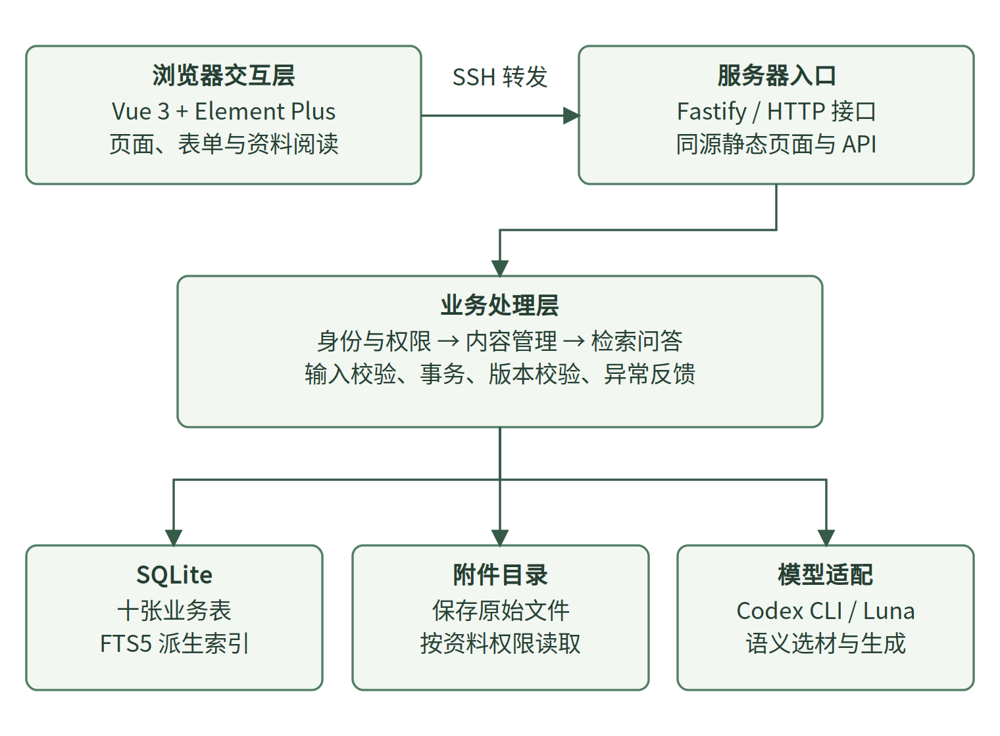

# 知序 · 课程知识管理系统

面向课程学习资料的知识管理应用，支持资料上传、分类标签、内容发布与归档、全文检索，以及带来源引用的 AI 多轮问答。

项目采用 Vue 3 + Fastify + SQLite，前端构建后由后端统一提供服务。知识管理与检索可独立运行，AI 问答需要另行配置模型服务。

## 功能

- **知识库**：浏览已发布资料，按分类、标签、资料类型等条件筛选，搜索标题和正文。
- **我的内容**：创建和编辑资料，上传文件，维护草稿、发布与归档状态。
- **文件与媒体**：保存附件；对支持的文本、PDF、DOCX 等资料解析正文；视频等媒体保留原文件供查看。
- **智能问答**：结合资料目录与检索片段生成回答，引用可追溯；支持新建、切换和管理个人会话。
- **用户与权限**：注册、登录、个人设置；管理员维护全站内容和用户。学生只能维护自己的资料，会话保持私有。
- **内容一致性**：资料变更后更新检索索引，对失效的历史引用进行校验。

## 技术与结构

| 层次 | 技术 | 用途 |
| --- | --- | --- |
| 前端 | Vue 3、TypeScript、Element Plus | 页面、表单和交互 |
| 后端 | Node.js、Fastify、Zod | API、参数校验和权限控制 |
| 数据存储 | SQLite、better-sqlite3 | 资料、账号、会话与附件元数据 |
| 检索 | FTS5、nodejieba、BM25 | 中文分词、全文检索和相关性排序 |
| 文件解析 | pdf-parse、JSZip | PDF 与 DOCX 等文件文本提取 |
| AI | RAG、兼容接口或 CLI 适配 | 依据资料生成带引用的回答 |



```text
course-knowledge-hub/
├── backend/
│   ├── course/           # 后端业务源码与接口测试
│   └── runtime/          # 仅跟踪配置示例，运行数据不提交
├── frontend/
│   └── src/course/       # Vue 页面、会话和用户管理组件
├── demo-data/external/   # 教材样例、来源和许可文本
├── docs/                 # 验证记录、来源说明
├── report/
│   ├── final/figures/    # PNG 设计图及可编辑 SVG
│   └── 数据字典.csv
├── tools/import-sources.mjs
└── run.sh
```

## 快速开始

推荐 **Linux 或 WSL，Node.js 24，npm**。已验证环境为 Linux、Node.js 24.21.0。SQLite 无需单独安装服务。

在项目根目录执行：

```bash
cd backend
npm ci
cd ../frontend
npm ci
npm run build
cd ..
bash run.sh
```

浏览器打开 **http://127.0.0.1:8210**。终端按 `Ctrl+C` 停止服务。

依赖安装需要网络。`better-sqlite3`、`nodejieba` 包含原生模块；没有适用的预编译包时，需要 Python 3、make 和 C++ 编译器。后端 `package.json` 保留了这些依赖及 esbuild 的安装脚本白名单；若安装日志提示必要脚本未执行，可在 `backend` 目录执行 `npm rebuild` 后重试。不要忽略依赖构建失败信息。

### 首次登录

首次启动自动初始化数据库和少量明确标注 AI 来源的示例资料，并生成 `admin` 与 `student` 账号。密码保存在本机：

```text
backend/runtime/course/accounts.txt
```

登录后可在个人设置中修改密码，也可以在登录页注册学生账号。运行数据、密码和会话均不纳入 Git。

### 远程服务器访问

服务默认仅监听服务器的 `127.0.0.1`。在自己电脑的 CMD、PowerShell 或终端建立 SSH 转发：

```bash
ssh -N -L 8210:127.0.0.1:8210 用户名@服务器地址
```

保持窗口打开，在自己电脑浏览器访问 `http://127.0.0.1:8210`。已有服务占用端口时，可通过 `COURSE_PORT` 改用空闲端口，并同步调整转发。

### 导入公开教材样例

服务启动后，在另一个终端进入项目根目录：

```bash
node tools/import-sources.mjs
```

导入脚本默认连接 `8210`，使用首次生成的管理员账号，按标题检查已有教材并补充附件、发布资料。管理员改过密码后，请通过页面上传或自行调整脚本认证方式。导入会写入当前运行数据库，结果保存在被 Git 忽略的 `report/evidence/`。

样例包含 Hello 算法、MDN、Pro Git 和 Think Python 等资料。作者、来源、许可及文件哈希见 [来源清单](demo-data/external/sources.json) 与 [第三方说明](docs/THIRD_PARTY_NOTICES.md)。

## AI 配置

将配置示例复制为本机配置：

```bash
cp backend/runtime/course.env.example backend/runtime/course.env
```

编辑后重启服务。可使用以下两种适配方式：

| 方式 | 配置 |
| --- | --- |
| 兼容 Chat Completions 的接口 | 填写 `COURSE_MODEL_URL`、`COURSE_MODEL_KEY`、`COURSE_MODEL_NAME`，保持 `COURSE_MODEL_PROVIDER` 为空 |
| 已登录的 Codex CLI | 设置 `COURSE_MODEL_PROVIDER=codex`，并保证服务器 PATH 中存在兼容的 `codex` 命令 |

接口 URL 应为基础地址，例如服务的 `/v1` 地址；程序会追加 `/chat/completions`。CLI 的模型和推理配置见示例文件，可用性取决于自己的服务和账号；适配参数见 [codex.ts](backend/course/codex.ts)。

程序不会携带开发者的密钥或 CLI 登录信息。未配置可用模型时，知识管理与全文检索仍可使用，问答提供检索降级结果。

## 开发与测试

后端类型检查和接口测试：

```bash
cd backend
npm run build
npm test
```

后端的 `build` 是 TypeScript 类型检查，启动时使用 `tsx` 加载源码。测试使用独立数据库，不应以演示数据库作为测试目标。

前端构建：

```bash
cd frontend
npm run build
```

开发时可分别运行后端 `npm run dev` 和前端 `npm run dev`。前端开发端口为 `5210`，默认代理到后端 `8210`；后端端口改变时需同步设置前端 `API_TARGET`。

源代码提交版已完成独立依赖安装、前后端构建、26 项后端测试以及临时端口首次启动检查。详细范围和限制见 [验证记录](docs/VALIDATION.md)。这些记录不代表所有系统和模型服务都已验证。

## 设计资料

- [数据字典](report/数据字典.csv)
- [需求核对](report/任务要求核对.csv)
- [设计图目录](report/final/figures)：包含角色用例、体系结构、ER 图、内容状态图、流程图和会话时序图；SVG 可继续编辑。

数据库建表和迁移逻辑位于 [store.ts](backend/course/store.ts)，不需要手动导入 SQL。资料接口、权限与问答入口位于 [app.ts](backend/course/app.ts)，检索实现在 [retrieval.ts](backend/course/retrieval.ts)。

## 代码来源与许可说明

本项目为课程实践成果，以既有 Agent 项目为参考和复用基础，裁剪后改造、新增课程知识管理模块。第三方框架、教材与既有基础不属于本项目独立原创内容。

当前未为项目整体指定开源许可证，也未在整理时擅自追加 MIT 等授权。第三方组件与教材保留各自许可，详见 [第三方说明](docs/THIRD_PARTY_NOTICES.md)。

## 上传到 GitHub

解压后进入包含本 README 的目录：

```bash
git init
git add .
git status
git commit -m "Initial commit"
git branch -M main
git remote add origin https://github.com/YOUR_USERNAME/course-knowledge-hub.git
git push -u origin main
```

先在 GitHub 创建空仓库，并替换上面的仓库地址。首次使用 Git 时，若提示身份缺失，请设置自己的 `user.name` 与 `user.email`。仓库没有预置 `.git`、远程地址或提交身份。
